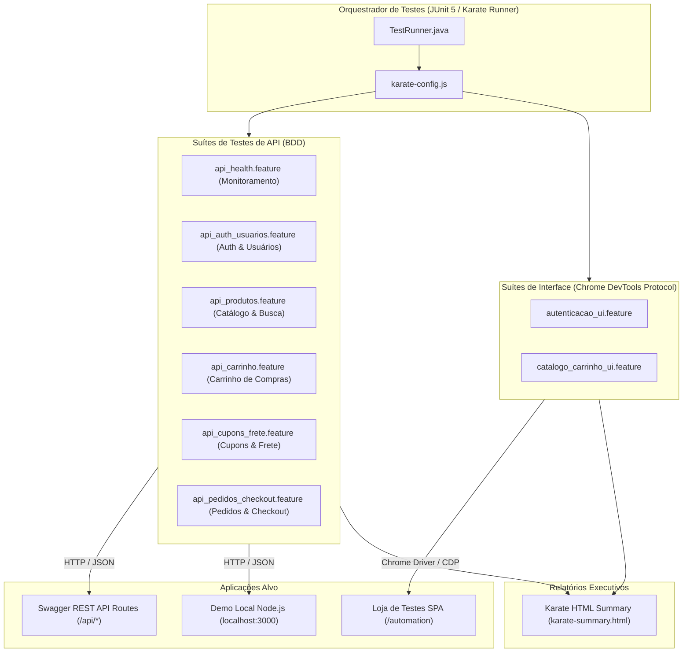

<p align="center">
  
</p>

<h1 align="center">Karate Framework API & UI Automation Lab 🥋</h1>

<p align="center">
  <b>Engenharia de Automação de Testes de Alta Performance para APIs REST e Interface E2E</b>
</p>

<p align="center">
  <a href="https://portfolio-omega-six-18.vercel.app/api-docs"></a>
  <a href="https://portfolio-omega-six-18.vercel.app/automation"></a>
  <a href="https://github.com/karatelabs/karate"></a>
  <a href="https://adoptium.net/"></a>
  <a href="https://maven.apache.org/"></a>
  <a href="https://junit.org/junit5/"></a>
</p>

---

## 📑 Índice

- [Visão Geral](#-visão-geral)
- [Destaques Técnicos](#-destaques-técnicos)
- [Diagrama de Arquitetura](#-diagrama-de-arquitetura)
- [Matriz de Cobertura da API REST (Swagger)](#-matriz-de-cobertura-da-api-rest-swagger)
- [Estrutura do Projeto](#-estrutura-do-projeto)
- [Pré-requisitos](#-pré-requisitos)
- [Instalação e Setup](#-instalação-e-setup)
- [Como Executar os Testes](#-como-executar-os-testes)
- [Scripts NPM Disponíveis](#-scripts-npm-disponíveis)
- [Relatórios de Execução](#-relatórios-de-execução)
- [Boas Práticas de QA Implementadas](#-boas-práticas-de-qa-implementadas)
- [Autor](#-autor)

---

## 🎯 Visão Geral

Este projeto é um laboratório de referência em **Engenharia de Qualidade de Software (QA)** focado na automação de testes de serviços backend e front-end com **Karate Framework 1.4.1**, **Maven** e **JUnit 5**.

A suíte cobre **100% dos endpoints REST** formalizados na documentação oficial [Swagger OpenAPI (/api-docs)](https://portfolio-omega-six-18.vercel.app/api-docs) da aplicação de portfólio, além de contemplar automação visual E2E com **Karate Driver** via Chrome DevTools Protocol (CDP) e uma aplicação local de demonstração totalmente desacoplada.

> 🔗 **Ambiente de Testes:** [https://portfolio-omega-six-18.vercel.app/automation](https://portfolio-omega-six-18.vercel.app/automation)  
> 📖 **Documentação Swagger:** [https://portfolio-omega-six-18.vercel.app/api-docs](https://portfolio-omega-six-18.vercel.app/api-docs)

---

## ⚡ Destaques Técnicos

- **Sem Boilerplate de Step Definitions**: Escrita direta de cenários executáveis com sintaxe nativa BDD/Gherkin no Karate.
- **Validação de Schemas e Contratos Estritos**: Asserções de tipos dinâmicos (`#string`, `#number`, `#regex`, `#array`, `#boolean`) e validação de payloads complexos JSON Path.
- **Ciclo Completo de E-Commerce**: Testes de ponta a ponta que simulam o fluxo real de compras:
  `Health Check ➔ Autenticação JWT ➔ Consulta de Produtos ➔ Gestão de Carrinho ➔ Aplicação de Cupons ➔ Cálculo de Frete por CEP ➔ Finalização de Pedido`.
- **Cobertura de Casos Negativos & Segurança**: Verificação rigorosa de status de erro (`400 Bad Request`, `401 Unauthorized`, `404 Not Found`, `405 Method Not Allowed`) e cabeçalhos de resposta HTTP (`Content-Type`, `Allow`, `Strict-Transport-Security`).
- **Automação Híbrida (API + UI)**: Execução de testes de interface no Google Chrome devidamente integrados com a suíte de serviços.
- **Execução Paralela e Relatórios Nativos**: Relatórios executivos gerados automaticamente em HTML com gráficos de tempo, timeline de execução e rastreamento completo de tráfego de rede.

---

## 🏗️ Diagrama de Arquitetura



---

## 📊 Matriz de Cobertura da API REST (Swagger)

A suíte cobre integralmente todos os módulos e operações descritas no Swagger:

| Módulo / Domínio | Método | Rota HTTP | Arquivo Feature | Cenários | Status |
| :--- | :---: | :--- | :--- | :---: | :---: |
| **Monitoramento** | `GET` | `/api/health` | [`api_health.feature`](karate-automation-portfolio/src/test/java/automation/api_health.feature) | **2** | 🟢 100% |
| **Autenticação** | `POST` | `/api/auth/login` | [`api_auth_usuarios.feature`](karate-automation-portfolio/src/test/java/automation/api_auth_usuarios.feature) | **4** | 🟢 100% |
| **Cadastro** | `POST` | `/api/auth/register` | [`api_auth_usuarios.feature`](karate-automation-portfolio/src/test/java/automation/api_auth_usuarios.feature) | **2** | 🟢 100% |
| **Sessão** | `POST` | `/api/auth/logout` | [`api_auth_usuarios.feature`](karate-automation-portfolio/src/test/java/automation/api_auth_usuarios.feature) | **1** | 🟢 100% |
| **Perfil** | `GET`, `PUT` | `/api/users/me` | [`api_auth_usuarios.feature`](karate-automation-portfolio/src/test/java/automation/api_auth_usuarios.feature) | **2** | 🟢 100% |
| **Catálogo** | `GET`, `POST` | `/api/products` | [`api_produtos.feature`](karate-automation-portfolio/src/test/java/automation/api_produtos.feature) | **4** | 🟢 100% |
| **Busca Textual** | `GET` | `/api/products/search` | [`api_produtos.feature`](karate-automation-portfolio/src/test/java/automation/api_produtos.feature) | **2** | 🟢 100% |
| **Gestão Produto** | `GET`, `DELETE` | `/api/products/{id}` | [`api_produtos.feature`](karate-automation-portfolio/src/test/java/automation/api_produtos.feature) | **3** | 🟢 100% |
| **Carrinho Geral** | `GET`, `POST`, `DELETE`| `/api/cart` | [`api_carrinho.feature`](karate-automation-portfolio/src/test/java/automation/api_carrinho.feature) | **6** | 🟢 100% |
| **Item Carrinho** | `PUT`, `DELETE` | `/api/cart/{id}` | [`api_carrinho.feature`](karate-automation-portfolio/src/test/java/automation/api_carrinho.feature) | **2** | 🟢 100% |
| **Cupons** | `POST` | `/api/coupons/validate` | [`api_cupons_frete.feature`](karate-automation-portfolio/src/test/java/automation/api_cupons_frete.feature) | **6** | 🟢 100% |
| **Frete CEP** | `POST` | `/api/shipping/calculate` | [`api_cupons_frete.feature`](karate-automation-portfolio/src/test/java/automation/api_cupons_frete.feature) | **4** | 🟢 100% |
| **Pedidos** | `GET`, `POST` | `/api/orders` | [`api_pedidos_checkout.feature`](karate-automation-portfolio/src/test/java/automation/api_pedidos_checkout.feature) | **3** | 🟢 100% |
| **Consulta Pedido**| `GET` | `/api/orders/{id}` | [`api_pedidos_checkout.feature`](karate-automation-portfolio/src/test/java/automation/api_pedidos_checkout.feature) | **2** | 🟢 100% |
| **Autenticação UI** | `Browser / CDP` | `/automation` | [`autenticacao_ui.feature`](karate-automation-portfolio/src/test/java/automation/autenticacao_ui.feature) | **4** | 🟢 100% |
| **Catálogo & Carrinho UI** | `Browser / CDP` | `/automation` | [`catalogo_carrinho_ui.feature`](karate-automation-portfolio/src/test/java/automation/catalogo_carrinho_ui.feature) | **3** | 🟢 100% |
| **Regras da Loja** | `HTTP / Contrato` | `/automation` | [`loja_testes.feature`](karate-automation-portfolio/src/test/java/automation/loja_testes.feature) | **9** | 🟢 100% |

> **Total da Suíte Unificada:** **9 Features / 59 Cenários Automatizados** (100% de sucesso e 0 falhas).

---

## 📁 Estrutura do Projeto

```text
karate-api-automation-lab/
├── demo/                                    # Aplicação local reproduzível (Node.js)
│   ├── index.html                           # Interface visual da demo (login & dashboard)
│   └── server.mjs                           # Servidor HTTP com endpoints de Wallet e Login
├── docs/
│   └── assets/
│       └── karate-summary.png               # Evidência oficial do relatório Karate
├── karate-automation-portfolio/             # Módulo Maven com suíte Karate JUnit 5
│   ├── pom.xml                              # Dependências do Karate 1.4.1 e Surefire
│   └── src/test/java/
│       ├── karate-config.js                 # Configurações globais, endpoints e timeouts
│       └── automation/
│           ├── TestRunner.java              # JUnit 5 Runner modular
│           ├── api_health.feature           # Monitoramento da API (/api/health)
│           ├── api_auth_usuarios.feature    # Login, Cadastro, Logout e Perfil
│           ├── api_produtos.feature         # Catálogo, Busca e Gestão de Produtos
│           ├── api_carrinho.feature         # Gestão Completa do Carrinho
│           ├── api_cupons_frete.feature     # Validação de Cupons e Cálculo de Frete
│           ├── api_pedidos_checkout.feature # Finalização de Compras e Pedidos
│           ├── loja_testes.feature          # Suíte combinada da Loja de Testes
│           ├── autenticacao_ui.feature      # Automação de interface no Chrome (Login)
│           ├── catalogo_carrinho_ui.feature # Automação de interface no Chrome (Catálogo)
│           ├── demo_wallet_api.feature      # Teste replicado da Wallet API local
│           ├── demo_login_api.feature       # Teste replicado de Login API local
│           └── demo_login_ui.feature        # Teste replicado de Login UI local
├── package.json                             # Scripts NPM integrados
├── pom.xml                                  # Maven Aggregator raiz
└── README.md                                # Documentação técnica principal
```

---

## 💻 Pré-requisitos

- **Java JDK 11 ou superior** (recomendado Java 17 ou 21 LTS - Eclipse Adoptium Temurin).
- **Apache Maven 3.9+** configurado nas variáveis de ambiente (`JAVA_HOME` e `PATH`).
- **Node.js 18+** e npm instalados.
- **Google Chrome** (para execução dos cenários de UI com Karate Driver).

---

## 🛠️ Instalação e Setup

Clone o repositório e compile o projeto com Maven:

```bash
git clone https://github.com/GalileoGuilherme/karate-api-automation-lab.git
cd karate-api-automation-lab
mvn clean compile
```

---

## 🚀 Como Executar os Testes

### 1. Executar a Suíte Completa de APIs (Swagger /api-docs)

Executa todos os 43 cenários de backend em alta velocidade:

```bash
npm test
# ou via Maven:
mvn test -Dtest=TestRunner#testAllApis
```

### 2. Executar por Módulo Específico da API

```bash
# Monitoramento e Health Check
npm run test:health
mvn test -Dtest=TestRunner#testHealthApi

# Autenticação e Usuários
npm run test:auth
mvn test -Dtest=TestRunner#testAuthUsuariosApi

# Catálogo e Produtos
npm run test:products
mvn test -Dtest=TestRunner#testProdutosApi

# Carrinho de Compras
npm run test:cart
mvn test -Dtest=TestRunner#testCarrinhoApi

# Cupons e Cálculo de Frete
npm run test:coupons
mvn test -Dtest=TestRunner#testCuponsFreteApi

# Pedidos e Checkout
npm run test:orders
mvn test -Dtest=TestRunner#testPedidosCheckoutApi
```

### 3. Executar Testes de Interface Gráfica (UI no Google Chrome)

Dispara a automação visual no navegador usando o Karate Driver com Chrome DevTools Protocol:

```bash
npm run test:ui
# ou via Maven:
mvn test -Dtest=TestRunner#testUiSuite
```

### 4. Executar a Aplicação Demo Local (Mock Desacoplado)

Inicie o servidor Node.js local em um terminal:

```bash
npm run demo
```

Em outro terminal, execute os testes da demo local:

```bash
npm run test:demo
# ou via Maven:
mvn test -Dtest=TestRunner#testDemoSuite
```

---

## 📋 Scripts NPM Disponíveis

| Comando | Descrição |
| --- | --- |
| `npm test` | **Executa a suíte master completa (todos os 59 cenários de API e UI)** |
| `npm run test:apis` | Alias para execução de todas as features de API |
| `npm run test:health` | Executa os testes de Health Check (`GET /api/health`) |
| `npm run test:auth` | Executa os testes de Login, Registro, Logout e Perfil |
| `npm run test:products` | Executa os testes de Catálogo, Busca e Produtos |
| `npm run test:cart` | Executa os testes de Carrinho de Compras |
| `npm run test:coupons` | Executa os testes de Validação de Cupons e Frete |
| `npm run test:orders` | Executa os testes de Criação e Consulta de Pedidos |
| `npm run test:ui` | Executa a suíte de interface gráfica no Google Chrome |
| `npm run test:loja` | Executa a suíte combinada da Loja pública |
| `npm run test:demo` | Executa os testes da aplicação demo local |
| `npm run test:all` | Executa todos os testes do projeto |
| `npm run demo` | Inicia a aplicação demo local em `http://localhost:3000` |
| `npm run report` | Abre automaticamente o relatório interativo HTML no navegador padrão |

---

## 📈 Relatórios de Execução

Ao final da execução, o Karate compila um relatório em HTML rico com tempos de resposta, diagramas de sequência, payloads de requisição/resposta e detalhes de cada asserção.

Para abrir no navegador padrão:

```powershell
npm run report
# ou diretamente via PowerShell:
start karate-automation-portfolio/target/karate-reports/karate-summary.html
```

<p align="center">
  
</p>

---

## 🏆 Boas Práticas de QA Implementadas

1. **Pirâmide de Testes (API-First)**: A base da automação é concentrada nos testes de serviços HTTP (rápidos, estáveis e determinísticos), reservando testes de interface para os fluxos visuais críticos.
2. **Idempotência e Isolamento de Estado**: Cada cenário garante a limpeza ou setup prévio dos dados (por exemplo, limpeza do carrinho via `DELETE /api/cart` antes de testar fechamento de pedido vazio).
3. **Asserções Robustas e Fuzzy Matching**: Validação combinada de valores exatos e tipos dinâmicos do Karate (`#string`, `#number`, `#regex`), garantindo resiliência a timestamps e IDs randômicos.
4. **Data-Driven Testing (Scenario Outline)**: Uso de matrizes de exemplos (`Examples:`) para testar múltiplas variações de cupons de desconto (`CYPRESS10`, `PLAYWRIGHT15`, `QALAB20`) de forma enxuta.
5. **Configuração de Ambiente Centralizada**: URL base, credenciais de teste e timeouts parametrizados centralmente em `karate-config.js`.

---

## 👤 Autor

**Galileo Guilherme**  
*QA Automation Specialist / Software Test Engineer*

- 🌐 **Portfolio & Labs**: [portfolio-omega-six-18.vercel.app](https://portfolio-omega-six-18.vercel.app/)
- 🐙 **GitHub**: [@GalileoGuilherme](https://github.com/GalileoGuilherme)
- 💼 **LinkedIn**: [linkedin.com/in/galileosilva](https://linkedin.com/in/galileosilva/)
- 📧 **Contato**: [galileoguilherme@outlook.com](mailto:galileoguilherme@outlook.com)

---

<p align="center">
  Desenvolvido com foco em excelência técnica, clareza e manutenibilidade contínua em Engenharia de QA.
</p>
