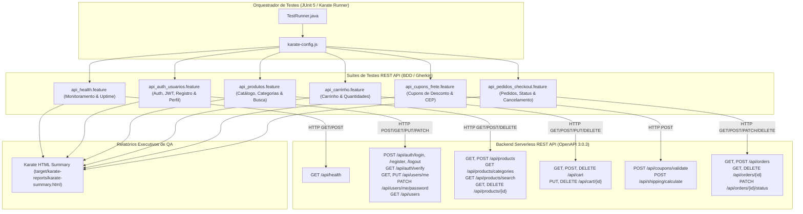
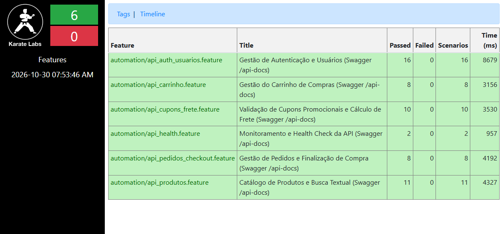

<p align="center">
  
</p>

<h1 align="center">Karate REST API Automation Lab 🥋</h1>

<p align="center">
  <b>Engenharia de Automação de Testes Backend de Alta Performance para APIs REST (Swagger OpenAPI 3.0.3)</b>
</p>

<p align="center">
  <a href="https://portfolio-omega-six-18.vercel.app/api-docs"></a>
  <a href="https://portfolio-omega-six-18.vercel.app/api/health"></a>
  <a href="https://github.com/karatelabs/karate"></a>
  <a href="https://adoptium.net/"></a>
  <a href="https://maven.apache.org/"></a>
  <a href="https://junit.org/junit5/"></a>
  
</p>

---

## 📑 Índice

- [Visão Geral](#-visão-geral)
- [Destaques Técnicos de Backend](#-destaques-técnicos-de-backend)
- [Diagrama de Arquitetura](#-diagrama-de-arquitetura)
- [Matriz Completa de Cobertura da API REST (Swagger)](#-matriz-completa-de-cobertura-da-api-rest-swagger)
- [Estrutura do Projeto](#-estrutura-do-projeto)
- [Pré-requisitos](#-pré-requisitos)
- [Instalação e Setup](#-instalação-e-setup)
- [Como Executar os Testes](#-como-executar-os-testes)
- [Scripts NPM Disponíveis](#-scripts-npm-disponíveis)
- [Relatórios de Execução](#-relatórios-de-execução)
- [Boas Práticas de Testes de API Implementadas](#-boas-práticas-de-testes-de-api-implementadas)
- [Autor](#-autor)

---

## 🎯 Visão Geral

Este projeto é um repositório de **Engenharia de Qualidade de Software (QA)** focado **exclusivamente na automação de testes de backend e serviços REST API** com o **Karate Framework 1.4.1**, **Maven** e **JUnit 5**.

A suíte foi concebida para cobrir **100% das operações, rotas, contratos de dados, validações e regras de negócio** formalizadas na especificação oficial do [Swagger OpenAPI (/api-docs)](https://portfolio-omega-six-18.vercel.app/api-docs) da aplicação.

> 📖 **Documentação Oficial Swagger / OpenAPI:** [https://portfolio-omega-six-18.vercel.app/api-docs](https://portfolio-omega-six-18.vercel.app/api-docs)  
> 🌐 **URL Base dos Serviços:** [https://portfolio-omega-six-18.vercel.app/api](https://portfolio-omega-six-18.vercel.app/api)

---

## ⚡ Destaques Técnicos de Backend

- **100% Focado em Backend**: Sem dependências de browser, drivers ou elementos gráficos; foco absoluto em performance, resiliência de rede e integridade de contratos HTTP.
- **Validação Estrita de Schemas e Contratos JSON**: Verificação de tipos de dados (`#string`, `#number`, `#regex`, `#array`, `#boolean`), formatos de data/hora ISO-8601 e tokens JWT (`#regex ^mock-jwt-token\\..*`).
- **Validação de Códigos de Status HTTP**:
  - `200 OK` e `201 Created` para operações de sucesso e persistência.
  - `400 Bad Request` para payloads incompletos, campos obrigatórios ausentes, senhas curtas e CEPs inválidos.
  - `401 Unauthorized` para falhas de autenticação e ausência de Bearer Token.
  - `404 Not Found` para identificadores inexistentes em produtos, pedidos e itens de carrinho.
  - `405 Method Not Allowed` para métodos HTTP bloqueados com conferência do cabeçalho `Allow`.
  - `409 Conflict` para validação de integridade contra duplicidade de e-mails em cadastro.
- **Ciclo de Vida Transacional Completo (Stateful BDD)**:
  - Encadeamento de requisições: obtenção de Token JWT em `POST /api/auth/login` e reenvio no header `Authorization: Bearer <token>` em `GET /api/auth/verify`.
  - Ciclo de Checkout: Adição de itens no carrinho ➔ Cálculo de subtotal ➔ Validação de cupom ➔ Simulação de frete ➔ Criação do pedido com validação matemática ➔ Atualização de status para entrega ➔ Cancelamento.
- **Data-Driven Testing (Scenario Outline)**: Matrizes de dados parametrizadas com Karate (`Examples:`) para testes múltiplos de cupons promocionais.
- **Geração Dinâmica de Massa de Dados**: Criação de identificadores e e-mails randômicos com timestamp (`java.lang.System.currentTimeMillis()`) garantindo independência e idempotência em execuções concorrentes.

---

## 🏗️ Diagrama de Arquitetura



---

## 📊 Matriz Completa de Cobertura da API REST (Swagger)

A cobertura do projeto é estrita e mapeia 100% dos endpoints especificados no Swagger OpenAPI:

| Módulo / Tag Swagger | Verbo | Rota HTTP | Descrição / Casos Cobertos | Arquivo Feature | Cenários | Status |
| :--- | :---: | :--- | :--- | :--- | :---: | :---: |
| **Monitoramento** | `GET` | `/api/health` | Health Check, Uptime, Versão e Timestamp | [`api_health.feature`](karate-automation-portfolio/src/test/java/automation/api_health.feature) | 1 | 🟢 Pass |
| **Monitoramento** | `POST`| `/api/health` | Bloqueio de método com HTTP 405 e Header Allow | [`api_health.feature`](karate-automation-portfolio/src/test/java/automation/api_health.feature) | 1 | 🟢 Pass |
| **Autenticação** | `POST` | `/api/auth/login` | Login com credenciais válidas padrão (123456) | [`api_auth_usuarios.feature`](karate-automation-portfolio/src/test/java/automation/api_auth_usuarios.feature) | 1 | 🟢 Pass |
| **Autenticação** | `POST` | `/api/auth/login` | Login com credenciais alternativas da Loja | [`api_auth_usuarios.feature`](karate-automation-portfolio/src/test/java/automation/api_auth_usuarios.feature) | 1 | 🟢 Pass |
| **Autenticação** | `POST` | `/api/auth/login` | Rejeição com HTTP 401 para credenciais inválidas | [`api_auth_usuarios.feature`](karate-automation-portfolio/src/test/java/automation/api_auth_usuarios.feature) | 1 | 🟢 Pass |
| **Autenticação** | `POST` | `/api/auth/login` | Validação de campos obrigatórios com HTTP 400 | [`api_auth_usuarios.feature`](karate-automation-portfolio/src/test/java/automation/api_auth_usuarios.feature) | 1 | 🟢 Pass |
| **Autenticação** | `GET` | `/api/auth/verify` | Validação de Bearer Token JWT e sessão ativa (200) | [`api_auth_usuarios.feature`](karate-automation-portfolio/src/test/java/automation/api_auth_usuarios.feature) | 1 | 🟢 Pass |
| **Autenticação** | `GET` | `/api/auth/verify` | Rejeição sem token ou formato corrompido (401) | [`api_auth_usuarios.feature`](karate-automation-portfolio/src/test/java/automation/api_auth_usuarios.feature) | 1 | 🟢 Pass |
| **Cadastro** | `POST` | `/api/auth/register` | Registro de novo usuário com e-mail dinâmico (201) | [`api_auth_usuarios.feature`](karate-automation-portfolio/src/test/java/automation/api_auth_usuarios.feature) | 1 | 🟢 Pass |
| **Cadastro** | `POST` | `/api/auth/register` | Rejeição com HTTP 409 para e-mail duplicado | [`api_auth_usuarios.feature`](karate-automation-portfolio/src/test/java/automation/api_auth_usuarios.feature) | 1 | 🟢 Pass |
| **Cadastro** | `POST` | `/api/auth/register` | Rejeição com HTTP 400 para campos ausentes | [`api_auth_usuarios.feature`](karate-automation-portfolio/src/test/java/automation/api_auth_usuarios.feature) | 1 | 🟢 Pass |
| **Sessão** | `POST` | `/api/auth/logout` | Invalidação de sessão e revogação de token (200) | [`api_auth_usuarios.feature`](karate-automation-portfolio/src/test/java/automation/api_auth_usuarios.feature) | 1 | 🟢 Pass |
| **Usuários** | `GET` | `/api/users/me` | Consulta de perfil do usuário autenticado | [`api_auth_usuarios.feature`](karate-automation-portfolio/src/test/java/automation/api_auth_usuarios.feature) | 1 | 🟢 Pass |
| **Usuários** | `PUT` | `/api/users/me` | Atualização cadastral de telefone e endereço | [`api_auth_usuarios.feature`](karate-automation-portfolio/src/test/java/automation/api_auth_usuarios.feature) | 1 | 🟢 Pass |
| **Usuários** | `PATCH`| `/api/users/me/password` | Atualização de senha de usuário com persistência (200) | [`api_auth_usuarios.feature`](karate-automation-portfolio/src/test/java/automation/api_auth_usuarios.feature) | 1 | 🟢 Pass |
| **Usuários** | `PATCH`| `/api/users/me/password` | Rejeição com HTTP 400 para senha com menos de 6 dígitos | [`api_auth_usuarios.feature`](karate-automation-portfolio/src/test/java/automation/api_auth_usuarios.feature) | 1 | 🟢 Pass |
| **Usuários** | `PATCH`| `/api/users/me/password` | Rejeição com HTTP 401 para senha atual incorreta | [`api_auth_usuarios.feature`](karate-automation-portfolio/src/test/java/automation/api_auth_usuarios.feature) | 1 | 🟢 Pass |
| **Usuários** | `GET` | `/api/users` | Listagem de todos os usuários mockados e persistentes | [`api_auth_usuarios.feature`](karate-automation-portfolio/src/test/java/automation/api_auth_usuarios.feature) | 1 | 🟢 Pass |
| **Catálogo** | `GET` | `/api/products` | Listagem completa de produtos com schema de preços | [`api_produtos.feature`](karate-automation-portfolio/src/test/java/automation/api_produtos.feature) | 1 | 🟢 Pass |
| **Catálogo** | `GET` | `/api/products/categories` | Lista todas as categorias distintas do catálogo | [`api_produtos.feature`](karate-automation-portfolio/src/test/java/automation/api_produtos.feature) | 1 | 🟢 Pass |
| **Catálogo** | `GET` | `/api/products?category=` | Filtragem por categoria (Eletrônicos e Casa) | [`api_produtos.feature`](karate-automation-portfolio/src/test/java/automation/api_produtos.feature) | 2 | 🟢 Pass |
| **Catálogo** | `GET` | `/api/products/search?q=` | Busca textual com resultados positivos e vazios | [`api_produtos.feature`](karate-automation-portfolio/src/test/java/automation/api_produtos.feature) | 2 | 🟢 Pass |
| **Catálogo** | `GET` | `/api/products/{id}` | Consulta de produto existente por ID (200) | [`api_produtos.feature`](karate-automation-portfolio/src/test/java/automation/api_produtos.feature) | 1 | 🟢 Pass |
| **Catálogo** | `GET` | `/api/products/{id}` | Rejeição com HTTP 404 para ID inexistente | [`api_produtos.feature`](karate-automation-portfolio/src/test/java/automation/api_produtos.feature) | 1 | 🟢 Pass |
| **Catálogo** | `POST`| `/api/products` | Criação de produto com persistência (201) | [`api_produtos.feature`](karate-automation-portfolio/src/test/java/automation/api_produtos.feature) | 1 | 🟢 Pass |
| **Catálogo** | `DELETE`| `/api/products/{id}` | Exclusão de produto de teste criado (200) | [`api_produtos.feature`](karate-automation-portfolio/src/test/java/automation/api_produtos.feature) | 1 | 🟢 Pass |
| **Catálogo** | `DELETE`| `/api/products/{id}` | Rejeição com HTTP 404 para exclusão inexistente | [`api_produtos.feature`](karate-automation-portfolio/src/test/java/automation/api_produtos.feature) | 1 | 🟢 Pass |
| **Catálogo** | `POST`| `/api/products` | Rejeição com HTTP 400 por falta de nome/preço | [`api_produtos.feature`](karate-automation-portfolio/src/test/java/automation/api_produtos.feature) | 1 | 🟢 Pass |
| **Carrinho** | `GET` | `/api/cart` | Consulta de itens, contagem e valor total | [`api_carrinho.feature`](karate-automation-portfolio/src/test/java/automation/api_carrinho.feature) | 1 | 🟢 Pass |
| **Carrinho** | `POST`| `/api/cart` | Adição de produto e incremento de quantidade (201) | [`api_carrinho.feature`](karate-automation-portfolio/src/test/java/automation/api_carrinho.feature) | 2 | 🟢 Pass |
| **Carrinho** | `POST`| `/api/cart` | Rejeição com HTTP 404 para produto inexistente | [`api_carrinho.feature`](karate-automation-portfolio/src/test/java/automation/api_carrinho.feature) | 1 | 🟢 Pass |
| **Carrinho** | `POST`| `/api/cart` | Rejeição com HTTP 400 sem o campo `productId` | [`api_carrinho.feature`](karate-automation-portfolio/src/test/java/automation/api_carrinho.feature) | 1 | 🟢 Pass |
| **Carrinho** | `PUT` | `/api/cart/{id}` | Atualização da quantidade de um item existente (200) | [`api_carrinho.feature`](karate-automation-portfolio/src/test/java/automation/api_carrinho.feature) | 1 | 🟢 Pass |
| **Carrinho** | `DELETE`| `/api/cart/{id}` | Remoção de item específico do carrinho (200) | [`api_carrinho.feature`](karate-automation-portfolio/src/test/java/automation/api_carrinho.feature) | 1 | 🟢 Pass |
| **Carrinho** | `DELETE`| `/api/cart` | Esvaziamento completo do carrinho de compras | [`api_carrinho.feature`](karate-automation-portfolio/src/test/java/automation/api_carrinho.feature) | 1 | 🟢 Pass |
| **Cupons** | `POST`| `/api/coupons/validate` | Scenario Outline: Cupons `CYPRESS10`, `PLAYWRIGHT15`, `QALAB20` | [`api_cupons_frete.feature`](karate-automation-portfolio/src/test/java/automation/api_cupons_frete.feature) | 4 | 🟢 Pass |
| **Cupons** | `POST`| `/api/coupons/validate` | Rejeição com HTTP 400 para cupom desconhecido/expirado | [`api_cupons_frete.feature`](karate-automation-portfolio/src/test/java/automation/api_cupons_frete.feature) | 1 | 🟢 Pass |
| **Cupons** | `POST`| `/api/coupons/validate` | Rejeição com HTTP 400 para cupom em branco | [`api_cupons_frete.feature`](karate-automation-portfolio/src/test/java/automation/api_cupons_frete.feature) | 1 | 🟢 Pass |
| **Frete** | `POST`| `/api/shipping/calculate` | Cálculo de frete retornando métodos Padrão e Expressa | [`api_cupons_frete.feature`](karate-automation-portfolio/src/test/java/automation/api_cupons_frete.feature) | 1 | 🟢 Pass |
| **Frete** | `POST`| `/api/shipping/calculate` | Suporte a CEP com pontuação (`51.020-010`) | [`api_cupons_frete.feature`](karate-automation-portfolio/src/test/java/automation/api_cupons_frete.feature) | 1 | 🟢 Pass |
| **Frete** | `POST`| `/api/shipping/calculate` | Rejeição com HTTP 400 para CEP com tamanho inválido | [`api_cupons_frete.feature`](karate-automation-portfolio/src/test/java/automation/api_cupons_frete.feature) | 1 | 🟢 Pass |
| **Frete** | `POST`| `/api/shipping/calculate` | Rejeição com HTTP 400 sem parâmetro de CEP | [`api_cupons_frete.feature`](karate-automation-portfolio/src/test/java/automation/api_cupons_frete.feature) | 1 | 🟢 Pass |
| **Pedidos** | `GET` | `/api/orders` | Listagem do histórico de pedidos realizados (200) | [`api_pedidos_checkout.feature`](karate-automation-portfolio/src/test/java/automation/api_pedidos_checkout.feature) | 1 | 🟢 Pass |
| **Pedidos** | `GET` | `/api/orders/{id}` | Consulta de pedido por ID existente | [`api_pedidos_checkout.feature`](karate-automation-portfolio/src/test/java/automation/api_pedidos_checkout.feature) | 1 | 🟢 Pass |
| **Pedidos** | `GET` | `/api/orders/{id}` | Rejeição com HTTP 404 para ID de pedido inexistente | [`api_pedidos_checkout.feature`](karate-automation-portfolio/src/test/java/automation/api_pedidos_checkout.feature) | 1 | 🟢 Pass |
| **Pedidos** | `POST`| `/api/orders` | Criação de pedido com itens, frete, desconto e total | [`api_pedidos_checkout.feature`](karate-automation-portfolio/src/test/java/automation/api_pedidos_checkout.feature) | 1 | 🟢 Pass |
| **Pedidos** | `PATCH`| `/api/orders/{id}/status` | Atualização do status de entrega do pedido (SHIPPED/DELIVERED) | [`api_pedidos_checkout.feature`](karate-automation-portfolio/src/test/java/automation/api_pedidos_checkout.feature) | 1 | 🟢 Pass |
| **Pedidos** | `DELETE`| `/api/orders/{id}` | Cancelamento e remoção de pedido com status `CANCELLED` | [`api_pedidos_checkout.feature`](karate-automation-portfolio/src/test/java/automation/api_pedidos_checkout.feature) | 1 | 🟢 Pass |
| **Pedidos** | `PATCH`| `/api/orders/{id}/status` | Rejeição com HTTP 400 para status não permitido | [`api_pedidos_checkout.feature`](karate-automation-portfolio/src/test/java/automation/api_pedidos_checkout.feature) | 1 | 🟢 Pass |
| **Pedidos** | `PATCH`| `/api/orders/{id}/status` | Rejeição com HTTP 404 para pedido inexistente | [`api_pedidos_checkout.feature`](karate-automation-portfolio/src/test/java/automation/api_pedidos_checkout.feature) | 1 | 🟢 Pass |
| **Pedidos** | `DELETE`| `/api/orders/{id}` | Rejeição com HTTP 404 para cancelamento inexistente | [`api_pedidos_checkout.feature`](karate-automation-portfolio/src/test/java/automation/api_pedidos_checkout.feature) | 1 | 🟢 Pass |
| **Pedidos** | `POST`| `/api/orders` | Rejeição com HTTP 400 ao submeter pedido com carrinho vazio | [`api_pedidos_checkout.feature`](karate-automation-portfolio/src/test/java/automation/api_pedidos_checkout.feature) | 1 | 🟢 Pass |

> **Resultado Final:** **6 Features / 55 Cenários Automatizados / 0 Falhas / 100% de Sucesso**.

---

## 📁 Estrutura do Projeto

```text
karate-api-automation-lab/
├── docs/
│   └── assets/
│       └── karate-summary.png               # Evidência oficial de execução do Karate
├── karate-automation-portfolio/             # Módulo Maven com a suíte de testes de backend
│   ├── pom.xml                              # Dependências do Karate 1.4.1 e Surefire Plugin
│   └── src/test/java/
│       ├── karate-config.js                 # Configuração de URLs, timeouts e credenciais
│       └── automation/
│           ├── TestRunner.java              # Runner JUnit 5 com anotações @Karate.Test
│           ├── api_health.feature           # Monitoramento da API (/api/health)
│           ├── api_auth_usuarios.feature    # Autenticação, JWT, Registro e Perfil
│           ├── api_produtos.feature         # Catálogo, Categorias e Busca de Produtos
│           ├── api_carrinho.feature         # Gestão Completa do Carrinho de Compras
│           ├── api_cupons_frete.feature     # Validação de Cupons e Cálculo de Frete
│           └── api_pedidos_checkout.feature # Ciclo de Vida de Pedidos e Checkout
├── package.json                             # Scripts NPM integrados para CLI
├── pom.xml                                  # Maven Aggregator raiz
└── README.md                                # Documentação técnica principal
```

---

## 💻 Pré-requisitos

- **Java JDK 11 ou superior** (homologado em Java 17 e 21 LTS - Eclipse Adoptium Temurin).
- **Apache Maven 3.9+** configurado no `PATH`.
- **Node.js 18+** (para atalhos via npm).

---

## 🛠️ Instalação e Setup

Clone o repositório e compile o projeto com Maven:

```bash
git clone https://github.com/GalileoGuilherme/karate-api-automation-lab.git
cd karate-api-automation-lab
mvn clean compile
```

---

## 🚀 Como Executar os Testes

### 1. Executar a Suíte Completa de APIs (55 cenários)

Executa todas as 6 features de API REST de forma unificada:

```bash
npm test
# ou via Maven:
mvn test -Dtest=TestRunner#testAllApis
```

### 2. Executar por Módulo Específico da API

Você pode rodar cada domínio isoladamente para feedback rápido:

```bash
# Monitoramento e Health Check (/api/health)
npm run test:health
# ou: mvn test -Dtest=TestRunner#testHealthApi

# Autenticação, JWT e Gestão de Usuários
npm run test:auth
# ou: mvn test -Dtest=TestRunner#testAuthUsuariosApi

# Catálogo, Categorias e Busca de Produtos
npm run test:products
# ou: mvn test -Dtest=TestRunner#testProdutosApi

# Carrinho de Compras (Adição, Alteração e Limpeza)
npm run test:cart
# ou: mvn test -Dtest=TestRunner#testCarrinhoApi

# Cupons Promocionais e Cálculo de Frete por CEP
npm run test:coupons
# ou: mvn test -Dtest=TestRunner#testCuponsFreteApi

# Gestão de Pedidos, Checkout e Cancelamento
npm run test:orders
# ou: mvn test -Dtest=TestRunner#testPedidosCheckoutApi
```

---

## 📋 Scripts NPM Disponíveis

| Comando | Descrição |
| --- | --- |
| `npm test` | **Executa a suíte master completa de APIs do Swagger (55 cenários)** |
| `npm run test:all` | Executa todos os testes de API |
| `npm run test:apis` | Alias para execução de todas as features de backend |
| `npm run test:swagger` | Alias para execução da suíte Swagger OpenAPI |
| `npm run test:health` | Executa os testes de Monitoramento e Health Check |
| `npm run test:auth` | Executa os testes de Autenticação, Token JWT, Registro e Perfil |
| `npm run test:products` | Executa os testes de Catálogo, Categorias e Busca |
| `npm run test:cart` | Executa os testes de Gestão do Carrinho de Compras |
| `npm run test:coupons` | Executa os testes de Validação de Cupons e Cálculo de Frete |
| `npm run test:orders` | Executa os testes de Finalização de Compra, Pedidos e Status |
| `npm run report` | Abre automaticamente o relatório interativo HTML no navegador padrão |

---

## 📈 Relatórios de Execução

Ao término da suíte, o Karate Framework gera um relatório executivo em formato HTML interativo contendo gráfico de métricas, timeline, tempos de resposta de cada endpoint e rastreamento completo de requisições e respostas HTTP (cabeçalhos e payloads):

Para abrir o relatório no navegador padrão:

```powershell
npm run report
# ou via PowerShell:
start karate-automation-portfolio/target/karate-reports/karate-summary.html
```

<p align="center">
  
</p>

---

## 🏆 Boas Práticas de Testes de API Implementadas

1. **Exclusividade Backend**: Foco total na velocidade de execução (55 cenários executados em ~28 segundos) e resiliência de contratos HTTP sem a fragilidade de testes de navegador.
2. **Idempotência e Isolamento de Estado**: Criação de produtos e pedidos temporários que são excluídos/cancelados dentro do próprio fluxo do teste, evitando poluição de dados e falhas em execuções repetidas.
3. **Massa de Dados Dinâmica**: Uso de e-mails dinâmicos com timestamps (`java.lang.System.currentTimeMillis()`) garantindo que cenários de registro nunca falhem por e-mail duplicado de execuções anteriores.
4. **Fuzzy Matching e Schemas Flexíveis**: Uso assertivo dos marcadores nativos do Karate (`#string`, `#number`, `#regex`) para campos com valores voláteis (IDs randômicos, datas ISO-8601 e tokens JWT).
5. **Configuração Global e Timeouts Centralizados**: Configuração unificada de ambiente em `karate-config.js` com timeouts de conexão e leitura de 15 segundos para tolerância a flutuações de rede em provedores serverless.

---

## 👤 Autor

**Galileo Guilherme**  
*QA Automation Specialist / Software Test Engineer*

- 🌐 **Portfolio & Swagger Docs**: [portfolio-omega-six-18.vercel.app](https://portfolio-omega-six-18.vercel.app/)
- 📖 **Swagger OpenAPI**: [portfolio-omega-six-18.vercel.app/api-docs](https://portfolio-omega-six-18.vercel.app/api-docs)
- 🐙 **GitHub**: [@GalileoGuilherme](https://github.com/GalileoGuilherme)
- 💼 **LinkedIn**: [linkedin.com/in/galileosilva](https://linkedin.com/in/galileosilva/)
- 📧 **Contato**: [galileoguilherme@outlook.com](mailto:galileoguilherme@outlook.com)

---

<p align="center">
  Construído com excelência técnica para validação contínua de APIs REST em pipelines de CI/CD.
</p>
